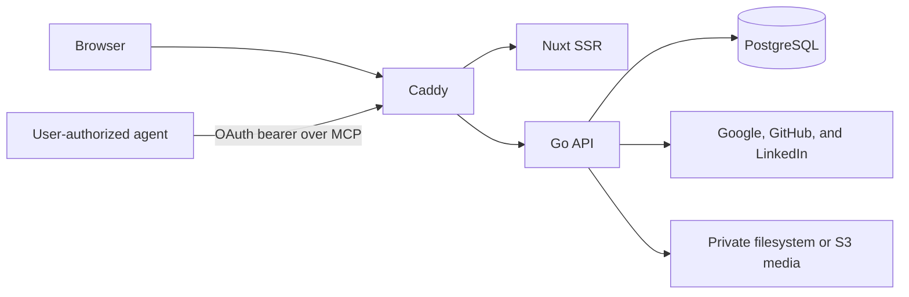

# Current-state architecture

This document describes the implemented system. Production serves
`https://aboutme.vn`; the [production runbook](runbooks/production.md) covers
operations. The [design](design/README.md) owns intended behavior.

## Running system

| Component  | Implemented responsibility                                                                                                  |
| ---------- | --------------------------------------------------------------------------------------------------------------------------- |
| Caddy      | One-origin routing, forwarding-header removal, and canonical client-IP delivery to Go                                       |
| Go server  | Health, user and agent authentication, sessions, resume HTTP/MCP, private media, publish, public read, and request policy   |
| Nuxt       | Landing page, login/session/agent-consent UI, typed API transport, fonts, presets, the authenticated editor, and public SSR |
| PostgreSQL | Auth, OAuth client/grant/token, session, user, resume, public-state, idempotency, and media-cleanup records                 |
| Media      | Private create-only filesystem or S3 objects behind validated server-owned keys                                             |

Daily development runs Go, Nuxt, and Caddy as native processes at
`http://localhost:20080`. They use the `aboutme_dev` database in the one shared
`aboutme-test-db` container. See the
[native development runbook](runbooks/native-development.md).

Authenticated development uses a separate native stack on ports 20440–20443. It
serves only `https://localhost:20443`, runs deterministic local Google and
LinkedIn OpenID Connect mocks on 20442, and still uses the shared `aboutme_dev`
database. Its disposable pinned Playwright image imports the invocation's Caddy
root into an isolated NSS database and writes only bounded local verdicts. It
does not change the host trust store or use a certificate bypass.

The Compose deployment runs PostgreSQL, MinIO, Go, Nuxt and Caddy. A one-shot
`db-setup` command creates the fixed database roles and grants, a one-shot
`migrate` command then applies migrations, and a media initializer sets up
private storage. PostgreSQL is not published to the host. Caddy is the only
published service. The current Compose Caddyfile serves HTTP; this is suitable
for deployment smoke checks.

Production runs on one GreenNode vServer in Ho Chi Minh City, with Caddy,
PostgreSQL 18, private vStorage media, and pgBackRest backups in vStorage, per
[ADR 0027](adr/0027-vietnam-hosted-production.md) and the
[Vietnam production design](design/vietnam-production.md). Cloudflare provides
DNS-only records; clients connect directly to the host. It runs one replica
under [ADR 0026](adr/0026-replica-scaling.md). Revocation leases, print jobs,
event subscribers, and limiters hold process-local state, which is correct only
with one replica. The [scaling contract](design/scaling/README.md) records which
parts of a multi-replica runtime are deferred.

Production enables email-and-password sign-up, Google sign-in, passkey and TOTP
second factors, and agent access. The public capabilities endpoint reports these
settings. See [scheduled jobs](architecture/resume-data.md#scheduled-jobs) for
lifecycle commands and backup expiry.

Database role and migration boundaries are described in
[resume data](architecture/resume-data.md#database-roles).

## Dependencies and trust boundaries

The [repository design](design/repository.md) owns dependency direction. Caddy
owns the viewer origin and canonical client-IP boundary. Go controls database
and private media access, while Nuxt owns resume layout. Detailed boundaries:

- [Authentication, cookie sessions, and agent bearer access](architecture/auth-and-agent-access.md).
- [Resume mutations, private media, database roles, and realtime](architecture/resume-data.md).
- [Editor state, public rendering, print capabilities, and exports](architecture/rendering-and-editor.md).

## Implemented HTTP surface

See
[implemented HTTP surface](architecture/auth-and-agent-access.md#implemented-http-surface).

## Implemented agent access

See
[implemented agent access](architecture/auth-and-agent-access.md#implemented-agent-access).

## Implemented application chrome

See
[implemented application chrome](architecture/rendering-and-editor.md#implemented-application-chrome).

## Implemented resume data layer

See
[implemented resume data layer](architecture/resume-data.md#implemented-resume-data-layer).

## Implemented private media boundary

See
[implemented private media boundary](architecture/resume-data.md#implemented-private-media-boundary).

## Implemented authenticated editor

See
[implemented authenticated editor](architecture/rendering-and-editor.md#implemented-authenticated-editor).

## Implemented public publish and SSR

See
[implemented public publish and SSR](architecture/rendering-and-editor.md#implemented-public-publish-and-ssr).

## Implemented realtime

See [implemented realtime](architecture/resume-data.md#implemented-realtime).

## Resume exports

See [resume exports](architecture/rendering-and-editor.md#resume-exports).

## Account privacy

See [account privacy](architecture/resume-data.md#account-privacy).

## Deferred work

Multi-replica runtime coordination and the Flutter client are not implemented.
