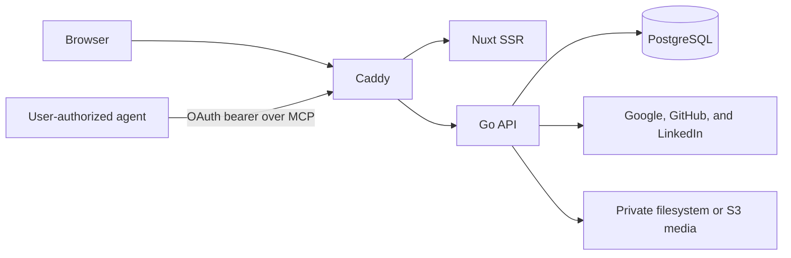

# Current-state architecture

This document describes the implemented system. Production serves
`https://aboutme.vn`; the [production runbook](runbooks/production.md) covers
operations. The [design](design/README.md) owns intended behavior.

## Running system

| Component  | Implemented responsibility                                                                                                  |
| ---------- | --------------------------------------------------------------------------------------------------------------------------- |
| Caddy      | One-origin routing, forwarding-header removal, and canonical client-IP delivery to Go                                       |
| Go server  | Health, user and agent authentication, sessions, resume HTTP/MCP, private media, publish, public read, and request policy   |
| Nuxt       | Landing page, login/session/agent-consent UI, typed API transport, fonts, presets, the authenticated editor, and public SSR |
| PostgreSQL | Auth, OAuth client/grant/token, session, user, resume, public-state, idempotency, and media-cleanup records                 |
| Media      | Private create-only filesystem or S3 objects behind validated server-owned keys                                             |

Daily development runs Go, Nuxt, and Caddy as native processes at
`http://localhost:20080`. They use the `aboutme_dev` database in the one shared
`aboutme-test-db` container. See the
[native development runbook](runbooks/native-development.md).

Authenticated development uses a separate native stack on ports 20440–20443. It
serves only `https://localhost:20443`, runs deterministic local Google and
LinkedIn OpenID Connect mocks on 20442, and still uses the shared `aboutme_dev`
database. Its disposable pinned Playwright image imports the invocation's Caddy
root into an isolated NSS database and writes only bounded local verdicts. It
does not change the host trust store or use a certificate bypass. Native macOS
browser execution and session ownership are accepted but pending under
[local tooling](design/local-tooling-simplification.md); this description covers
the existing container path. The pending runtime-smoke CI job is not evidence of
an executed startup check.

The Compose deployment runs PostgreSQL, MinIO, Go, Nuxt and Caddy. MinIO stores
media for self-hosters and stands in for production vStorage (S3) in local
deployments and media storage tests. A one-shot `db-setup` command creates the
fixed database roles and grants, a one-shot `migrate` command then applies
migrations, and a media initializer sets up private storage. PostgreSQL is not
published to the host. Caddy is the only published service. The current Compose
Caddyfile serves HTTP; this is suitable for deployment smoke checks.

Production runs on one GreenNode vServer in Ho Chi Minh City, with Caddy,
PostgreSQL 18, private vStorage media, and pgBackRest backups in vStorage, per
[ADR 0026](adr/0026-vietnam-hosted-production.md) and the
[Vietnam production design](design/vietnam-production.md). Cloudflare provides
DNS-only records; clients connect directly to the host. It runs one replica
under [ADR 0025](adr/0025-replica-scaling.md). Revocation leases, print jobs,
event subscribers, and limiters hold process-local state, which is correct only
with one replica. The [scaling contract](design/scaling/README.md) records which
parts of a multi-replica runtime are deferred.

Production enables email-and-password sign-up, Google sign-in, passkey and TOTP
second factors, and agent access. The public capabilities endpoint reports these
settings. See [scheduled jobs](architecture/resume-data.md#scheduled-jobs) for
lifecycle commands and backup expiry.

Database role and migration boundaries are described in
[resume data](architecture/resume-data.md#database-roles).

## Implemented CrowdSec storage and privacy

The host source uses a separate `crowdsec` database and least-privilege role in
the existing PostgreSQL 18 cluster. Root peer authentication through the Unix
socket admits the engine and retention helpers; application identities have no
access. There is no TCP, password, application-database, or SQLite fallback. The
cluster still shares memory, WAL, backups, and recovery failures.

Every schema-capable engine or `cscli` call requires the complete read-only
catalog, ownership, grants, logging, statistics, and database-epoch gate. Fresh
provisioning disables table autovacuum and sets every column statistics target
to zero before ingestion. An hourly serialized `VACUUM (ANALYZE FALSE)` replaces
ordinary automatic maintenance. Statistics contamination requires the operator's
`crowdsec-migrate.sh --reset`. The
[privacy contract](design/crowdsec-http-privacy.md#database-and-authorization)
owns exact connection, policy, and logging bounds.

Startup and five-minute runtime retention verify physical cleanup and renew a
short-lived root-owned lease only on success. An independent watchdog closes
consumer admission on invalid policy, database epoch, clock, lease, or
scheduling state. Failure stops both Caddy modes, CrowdSec, and the firewall
bouncer, clears their owned state, and leaves PostgreSQL available to the app.
Ordinary host-bundle installation invokes `crowdsec-migrate.sh` before the
separate image deployment. Its no-op path leaves service state unchanged; it is
not a health repair. The
[storage-switch contract](design/crowdsec-http-privacy.md#migration-loss-and-release-order)
owns order, loss, and recovery. Automated cluster restore does not reset
CrowdSec; the operator must complete notice reconciliation and explicit reset
before consumers resume under the
[restore contract](design/crowdsec-http-privacy.md#backups-and-restore).

The direct-edge feed has seven allowlisted fields. Only unknown routes returning
400, 404, or 405 may contribute an escaped target path of at most 512 bytes;
known routes, queries, headers, and bodies contribute no target sample. Feeds
and sensitive consumer logs stay on no-swap tmpfs. Configuration disables
community, console, and intelligence clients; this describes configuration, not
an observed absence of outbound traffic. Physical cluster backups include
CrowdSec under the
[accepted backup lifetime](design/crowdsec-http-privacy.md#backups-and-restore).

This section describes implemented source and configuration. Deployment requires
exact-release CI and production proof through the
[CrowdSec PostgreSQL runbook](runbooks/crowdsec-postgresql.md).

## Dependencies and trust boundaries

The [repository design](design/repository.md) owns dependency direction. Caddy
owns the viewer origin and canonical client-IP boundary. Go controls database
and private media access, while Nuxt owns resume layout. Detailed boundaries:

- [Authentication, cookie sessions, and agent bearer access](architecture/auth-and-agent-access.md).
- [Resume mutations, private media, database roles, and realtime](architecture/resume-data.md).
- [Editor state, public rendering, print capabilities, and exports](architecture/rendering-and-editor.md).

## Implemented HTTP surface

See
[implemented HTTP surface](architecture/auth-and-agent-access.md#implemented-http-surface).

## Implemented agent access

See
[implemented agent access](architecture/auth-and-agent-access.md#implemented-agent-access).

## Implemented application chrome

See
[implemented application chrome](architecture/rendering-and-editor.md#implemented-application-chrome).

## Implemented resume data layer

See
[implemented resume data layer](architecture/resume-data.md#implemented-resume-data-layer).

## Implemented private media boundary

See
[implemented private media boundary](architecture/resume-data.md#implemented-private-media-boundary).

## Implemented authenticated editor

See
[implemented authenticated editor](architecture/rendering-and-editor.md#implemented-authenticated-editor).

## Implemented public publish and SSR

See
[implemented public publish and SSR](architecture/rendering-and-editor.md#implemented-public-publish-and-ssr).

## Implemented realtime

See [implemented realtime](architecture/resume-data.md#implemented-realtime).

## Resume exports

See [resume exports](architecture/rendering-and-editor.md#resume-exports).

## Account privacy

See [account privacy](architecture/resume-data.md#account-privacy).

## Deferred work

Multi-replica runtime coordination and the Flutter client are not implemented.
