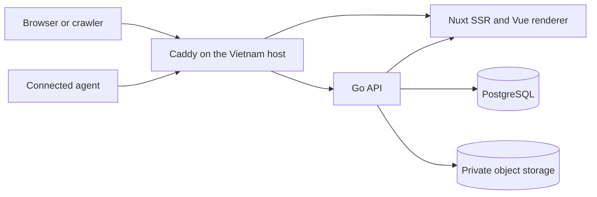

# aboutme design

This directory defines the intended product and architecture. Design v4 was
approved on 2026-08-12 and amended by every accepted ADR since.
[Decision status](decisions.md) lists the ADRs and the change process; an
accepted ADR controls its decision until contradicting text here is fixed.

Current behavior lives in code, deployment configuration, and
[`../api/openapi.yaml`](../api/openapi.yaml). The current-state narrative is
[`../architecture.md`](../architecture.md).

## Pages

| Section | File                                                                   | Purpose                                                                   |
| ------- | ---------------------------------------------------------------------- | ------------------------------------------------------------------------- |
| 1       | [Product](product.md)                                                  | Users, journeys, scope, public namespace, and publish states              |
| 2       | [System](system.md)                                                    | Components, route ownership, renderer and failure boundaries              |
| 3       | [Data](data.md)                                                        | Relational model, resume document, validation, and versions               |
| 4       | [API](api.md)                                                          | HTTP conventions, endpoints, photo intake, and write safety               |
| 5       | [Web and rendering](web.md)                                            | Web surfaces, UI toolkit, renderer, templates, and print                  |
| 5a      | [Localization](localization.md)                                        | Vietnamese and English interface, separate from resume text               |
| 5b      | [Security](security.md)                                                | Identity, sessions, CSRF, agent OAuth, limits, and content                |
| 5c      | [Second-factor authentication](second-factor-authentication.md)        | Shared passkey, TOTP, recovery, and epoch rules                           |
| 5d      | [Passkey contract](passkey-second-factor-contract.md)                  | Pending, WebAuthn, recovery, mail, and passkey storage shapes             |
| 5e      | [Authenticator-app contract](totp-second-factor-contract.md)           | TOTP routes, failure budget, and storage                                  |
| 5f      | [TOTP key management](totp-key-management.md)                          | Sealing, key ring, rotation, and key failures                             |
| Other   | [AWS TOTP key management](aws-totp-key-management.md)                  | Undeployed ECS key injection, rotation, and monitoring reference          |
| 6       | [Deployment](deployment.md)                                            | Environments, trust boundaries, media, mail, and migrations               |
| 6a      | [Vietnam production](vietnam-production.md)                            | Live host, DNS, database, secrets, deploy, and alarms                     |
| 6b      | [Release fence](passkey-release-fence.md)                              | Minimum production release, operation lock, and IAM                       |
| 6c      | [Single-host AWS reference](single-host-production.md)                 | Retained AWS deployment design                                            |
| 6d      | [CloudFront edge](cloudfront-edge.md)                                  | Undeployed AWS edge reference; not live operations                        |
| Other   | [CloudFront origin](cloudfront-origin.md)                              | AWS reference origin access, certificates, and client-address trust       |
| Other   | [CloudFront delivery](cloudfront-delivery.md)                          | AWS reference TLS, DNS, forwarding, caching, headers, WAF, and operations |
| Other   | [CloudFront verification](cloudfront-verification.md)                  | AWS reference migration, parity, tests, and unresolved facts              |
| 6e      | [CrowdSec HTTP privacy](crowdsec-http-privacy.md)                      | Live edge request feed, redaction, and abuse detection                    |
| 6f      | [Vietnam host memory](vietnam-host-memory.md)                          | Host memory ceilings, storage, and verification                           |
| 6g      | [Restore drill networking](restore-drill-networking.md)                | Temporary outbound access for the backup restore drill                    |
| Other   | [vMonitor quota renewal](vmonitor-quota-renewal.md)                    | Scheduled free alarm quota renewal, trust boundaries, and failure rules   |
| 7       | [Repository boundaries](repository.md)                                 | Sources of truth and dependency direction                                 |
| 8       | [Realtime](realtime.md)                                                | Autosave, Server-Sent Events, and fallback                                |
| 9       | [Operations](operations.md)                                            | Privacy lifecycle, export, deletion, monitoring, and checks               |
| 9a      | [Vietnam host operations](vietnam-host-operations.md)                  | Account deletion, key rotation, recovery, and verification                |
| Other   | [Host operations delivery](vietnam-host-operations-delivery.md)        | Wire protocol, proof transport, and hosted checks                         |
| 10      | [Decision status](decisions.md)                                        | ADR index, open gates, and change process                                 |
| Other   | [Numeric budgets](budgets.md)                                          | Hard limits, rate policies, SLOs, and benchmark protocol                  |
| Other   | [Vietnam tech resumes](vietnam-tech-resumes.md)                        | Resume language and writing rules for developers in Vietnam               |
| Other   | [Font catalog](fonts.md)                                               | Font license gate, provenance, coverage, and fallback                     |
| Other   | [MCP owner workflow](mcp-owner-workflow.md)                            | Official-SDK client run that copies one resume into Vietnamese            |
| Other   | [MCP client compatibility](mcp-client-compatibility.md)                | OAuth rules Claude and TypeScript SDK clients need                        |
| Other   | [MCP Client ID Metadata Documents](mcp-cimd.md)                        | Proposal: motivation, sources, release, and owner decisions               |
| Other   | [MCP CIMD metadata fetching](mcp-cimd-fetch.md)                        | Proposal: URL validation, fetch, SSRF, documents, cache, and limits       |
| Other   | [MCP CIMD authorization](mcp-cimd-authorization.md)                    | Proposal: consent, stored clients, errors, privacy, and compatibility     |
| Other   | [MCP CIMD verification](mcp-cimd-verification.md)                      | Proposal: abuse cases and acceptance checks                               |
| Other   | [MCP guide](mcp-guide.md)                                              | Public page on connecting an AI assistant through MCP                     |
| Other   | [MCP guide copy](mcp-guide-copy.md)                                    | Vietnamese and English text of the MCP guide                              |
| Other   | [Templates](templates/README.md)                                       | Preset data, tokens, colors, geometry, and print behavior                 |
| Other   | [Scaling](scaling/README.md)                                           | What a second serving replica needs                                       |
| Other   | [Link previews](link-previews.md)                                      | Page tags, preview card, and platform rules for shared links              |
| Other   | [Link-preview card](link-preview-card.md)                              | Card and publish-dialog preview visuals                                   |
| Other   | [Deployment transparency](deployment-transparency/README.md)           | Running digests, signed provenance, SBOMs, and the verify page            |
| Other   | [LinkedIn sign-in](linkedin-sign-in.md)                                | LinkedIn OIDC flow, account linking, and app setup                        |
| Other   | [LinkedIn import](linkedin-import.md)                                  | New resume from an English LinkedIn Save to PDF                           |
| Other   | [LinkedIn import parser](linkedin-import-parser.md)                    | Extraction, lines, detection, mapping, dates, and bounds                  |
| Other   | [LinkedIn import verification](linkedin-import-verification.md)        | Fixtures, test cases, compatibility, and open facts                       |
| Other   | [LinkedIn import page](linkedin-import-ui.md)                          | Import page states, layout, accessibility, and copy                       |
| Other   | [Viewer analytics](viewer-analytics/README.md)                         | View counts and sign in to view, with no viewer data kept                 |
| Other   | [Public page bar and theme](public-page-theme.md)                      | Page bar, owner color scheme, and the dark palette rule                   |
| Other   | [Community showcase](showcase.md)                                      | Showcase product scope, decisions, and approvals                          |
| Other   | [Showcase contract](showcase-contract.md)                              | Listing fields, filters, delivery, revocation, and compatibility          |
| Other   | [Showcase copy](showcase-copy.md)                                      | Approved bilingual interface and legal text                               |
| Other   | [UI: logo and seal](ui/identity-and-seal.md)                           | Logo, public seal, and state marks                                        |
| Other   | [UI: typography and tokens](ui/typography-and-tokens.md)               | Chrome type, color tokens, spacing, radius, buttons, dialogs              |
| Other   | [UI: landing and Library](ui/landing-and-library.md)                   | Landing page and template Library layout                                  |
| Other   | [UI: showcase page](ui/showcase.md)                                    | Page composition and shared interaction rules                             |
| Other   | [UI: showcase filters](ui/showcase-filters.md)                         | Narrow-screen controls, sheet, active filters, and desktop rail           |
| Other   | [UI: showcase results](ui/showcase-results.md)                         | Grid, tiles, invitation, pagination, and result states                    |
| Other   | [UI: shell and editor](ui/shell-and-editor.md)                         | App shell, account pages, resume list, editor, and settings               |
| Other   | [UI: responsive and accessibility](ui/responsive-and-accessibility.md) | Narrow editor layouts, motion, and accessibility                          |
| Section | File                                                                   | Purpose                                                                   |
| ------- | ---------------------------------------------------------------------- | ---------------------------------------------------------------------     |
| Section | File                                                                   | Purpose                                                                   |
| ------- | ---------------------------------------------------------------------- | ------------------------------------------------------------------------- |

## System summary

Five rules cut across every page:

1. A resume is the public entity. User accounts have no public page or public
   identifier.
2. One pure Vue renderer produces the editor preview, public HTML, PDF, images,
   and template test output.
3. Every resume write, from the editor or a connected agent, passes one
   validated aggregate boundary with optimistic concurrency and transactional
   idempotency.
4. Caddy is the sole client-IP trust boundary. Go accepts the canonical client
   address only from configured trusted proxies.
5. GitHub CI is the full delivery gate; a tag or deploy waits for green CI on
   the exact release commit ([ADR 0024](../adr/0024-delivery-gates.md)).
