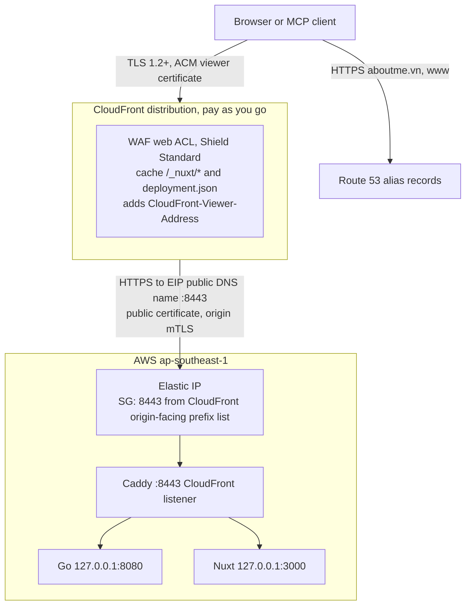

# CloudFront edge

This page describes the undeployed AWS reference edge under
[ADR 0025](../adr/0025-single-host-production.md): CloudFront in front of one
EC2 host, with no load balancer, and Route 53 DNS. Production uses the
[Vietnam host](vietnam-production.md) and Cloudflare DNS-only under
[ADR 0027](../adr/0027-vietnam-hosted-production.md). Follow the
[production runbook](../runbooks/production.md) for live operations. Reusing
this AWS edge requires a new reviewed infrastructure and data-transfer decision.

**Owner approval** marks a choice the owner made before the work that depended
on it; the owner approved all of them. **Verify** marks a fact from
documentation or community sources that devops confirms on the account
([facts to verify](cloudfront-verification.md#facts-to-verify)).

## Why

Measurements on 2026-09-25 found slow and failed origin fetches only through
Cloudflare locations far from Singapore, in Asian daytime: first-byte times up
to 6.4 seconds through Hong Kong while Singapore stayed near 0.2 seconds
(`.dev/prod-checks/origin-latency/poll-now.log`), and 522 and 525 errors through
the United States and Japan in the same investigation. The public internet path
from distant Cloudflare locations to the origin is the cause. CloudFront fetches
from AWS origins over the AWS backbone and has edges in Hanoi and Saigon
([features][cf-features]). The owner chose it over Cloudflare Argo, on condition
that it is as secure as today.

## Request path

Everything behind Caddy is unchanged: task layout, Go's loopback trust of
`X-Real-IP`, RDS, S3, SES, and jobs.

## Origin access

See [Origin access](cloudfront-origin.md#origin-access).

## Origin certificate

See [Origin certificate](cloudfront-origin.md#origin-certificate).

## Viewer TLS, hostnames, and DNS

See
[Viewer TLS, hostnames, and DNS](cloudfront-delivery.md#viewer-tls-hostnames-and-dns).

## Cache and forwarding

See [Cache and forwarding](cloudfront-delivery.md#cache-and-forwarding).

## Client address

See [Client address](cloudfront-origin.md#client-address).

## Response headers

See [Response headers](cloudfront-delivery.md#response-headers).

## DDoS and WAF

See [DDoS and WAF](cloudfront-delivery.md#ddos-and-waf).

## Deploys and monitoring

See [Deploys and monitoring](cloudfront-delivery.md#deploys-and-monitoring).

## Privacy

See [Privacy](cloudfront-delivery.md#privacy).

## Cost

In the 30 days to 2026-09-25 the host sent 2.9 GB and CloudWatch received
443,000 log events from all containers, an upper bound on requests. CloudFront's
always-free tier is 1 TB and 10 million requests a month; beyond it, Vietnam and
Singapore cost USD 0.120 per GB and USD 0.0120 per 10,000 HTTPS requests ([pay
as you go][cf-payg]).

| Item                        | USD per month                            |
| --------------------------- | ---------------------------------------- |
| CloudFront, origin fetches  | 0 inside the free tier                   |
| ACM viewer certificate      | 0 ([ACM pricing][acm-price])             |
| ACM exportable origin cert  | about 2.75 (14 per 198-day renewal)      |
| Imported client certificate | No charge listed; **Verify** on the bill |
| AWS WAF, if approved        | 8 plus 0.60 per million requests         |
| **Total**                   | **about 11**                             |

The flat-rate Free plan (USD 0, WAF included) lacks origin mTLS and custom
policies; Business (USD 200) is the first with origin mTLS ([plans][cf-plans]).
Cloudflare Argo is USD 5 a month plus USD 0.10 per GB by third-party accounts;
Cloudflare's pages give no price, so that figure is unverified.

## Security parity

See [Security parity](cloudfront-verification.md#security-parity).

## Migration

See [Migration](cloudfront-verification.md#migration).

## Test plan

See [Test plan](cloudfront-verification.md#test-plan).

## Facts to verify

See [Facts to verify](cloudfront-verification.md#facts-to-verify).

## Sources

- [ACM DNS validation][acm-dns]
- [ACM events][acm-events]
- [ACM exportable certificates][acm-export]
- [ACM pricing][acm-price]
- [CloudFront Authorization forwarding][cf-auth]
- [CloudFront managed cache policies][cf-cache]
- [CloudFront viewer certificate requirements][cf-cert]
- [CloudFront custom origin behavior][cf-custom]
- [CloudFront features][cf-features]
- [CloudFront request headers][cf-headers]
- [CloudFront origin mTLS][cf-mtls]
- [CloudFront origin client certificates][cf-mtls-cert]
- [CloudFront origin mTLS availability][cf-mtls-enable]
- [CloudFront origin request policy API][cf-orp-api]
- [CloudFront origin settings][cf-origin]
- [CloudFront origin TLS][cf-origin-tls]
- [CloudFront pay-as-you-go pricing][cf-payg]
- [CloudFront flat-rate plans][cf-plans]
- [CloudFront origin-facing prefix list][cf-prefix]
- [CloudFront quotas][cf-quotas]
- [CloudFront VPC origins][cf-vpc]
- [Cloudflare DDoS protection][cfl-ddos]
- [Cloudflare CNAME flattening][cfl-flatten]
- [Cloudflare Full (strict)][cfl-strict]
- [Cloudflare record TTL][cfl-ttl]
- [Cloudflare managed WAF rules][cfl-waf]
- [Let's Encrypt rate limits][le-limits]
- [NGINX IPv6 viewer-address ticket][nginx-2524]
- [Route 53 pricing][r53-price]
- [Shield Standard][shield]
- [SSM parameter tiers][ssm-tiers]
- [VPC prefix list weights][vpc-pl-weight]
- [VPC pricing][vpc-price]
- [AWS WAF baseline rule groups][waf-crs]
- [AWS WAF pricing][waf-price]

[acm-dns]: https://docs.aws.amazon.com/acm/latest/userguide/dns-validation.html
[acm-events]:
  https://docs.aws.amazon.com/acm/latest/userguide/supported-events.html
[acm-export]:
  https://docs.aws.amazon.com/acm/latest/userguide/acm-exportable-certificates.html
[acm-price]: https://aws.amazon.com/certificate-manager/pricing/
[cf-auth]:
  https://docs.aws.amazon.com/AmazonCloudFront/latest/DeveloperGuide/add-origin-custom-headers.html#add-origin-custom-headers-forward-authorization
[cf-cache]:
  https://docs.aws.amazon.com/AmazonCloudFront/latest/DeveloperGuide/using-managed-cache-policies.html
[cf-cert]:
  https://docs.aws.amazon.com/AmazonCloudFront/latest/DeveloperGuide/cnames-and-https-requirements.html
[cf-custom]:
  https://docs.aws.amazon.com/AmazonCloudFront/latest/DeveloperGuide/RequestAndResponseBehaviorCustomOrigin.html
[cf-features]: https://aws.amazon.com/cloudfront/features/
[cf-headers]:
  https://docs.aws.amazon.com/AmazonCloudFront/latest/DeveloperGuide/adding-cloudfront-headers.html
[cf-mtls]:
  https://docs.aws.amazon.com/AmazonCloudFront/latest/DeveloperGuide/origin-mtls-authentication.html
[cf-mtls-cert]:
  https://docs.aws.amazon.com/AmazonCloudFront/latest/DeveloperGuide/origin-certificate-management-certificate-manager.html
[cf-mtls-enable]:
  https://docs.aws.amazon.com/AmazonCloudFront/latest/DeveloperGuide/origin-enable-mtls-distributions.html
[cf-orp-api]:
  https://docs.aws.amazon.com/cloudfront/latest/APIReference/API_OriginRequestPolicyHeadersConfig.html
[cf-origin]:
  https://docs.aws.amazon.com/AmazonCloudFront/latest/DeveloperGuide/DownloadDistValuesOrigin.html
[cf-origin-tls]:
  https://docs.aws.amazon.com/AmazonCloudFront/latest/DeveloperGuide/using-https-cloudfront-to-custom-origin.html
[cf-payg]: https://aws.amazon.com/cloudfront/pricing/pay-as-you-go/
[cf-plans]:
  https://docs.aws.amazon.com/AmazonCloudFront/latest/DeveloperGuide/flat-rate-pricing-plan.html
[cf-prefix]:
  https://docs.aws.amazon.com/AmazonCloudFront/latest/DeveloperGuide/LocationsOfEdgeServers.html
[cf-quotas]:
  https://docs.aws.amazon.com/AmazonCloudFront/latest/DeveloperGuide/cloudfront-limits.html
[cf-vpc]:
  https://docs.aws.amazon.com/AmazonCloudFront/latest/DeveloperGuide/private-content-vpc-origins.html
[cfl-ddos]: https://developers.cloudflare.com/ddos-protection/
[cfl-flatten]:
  https://developers.cloudflare.com/dns/cname-flattening/set-up-cname-flattening/
[cfl-strict]:
  https://developers.cloudflare.com/ssl/origin-configuration/ssl-modes/full-strict/
[cfl-ttl]:
  https://developers.cloudflare.com/dns/manage-dns-records/reference/ttl/
[cfl-waf]: https://developers.cloudflare.com/waf/managed-rules/
[le-limits]: https://letsencrypt.org/docs/rate-limits/
[nginx-2524]: https://trac.nginx.org/nginx/ticket/2524
[r53-price]: https://aws.amazon.com/route53/pricing/
[shield]:
  https://docs.aws.amazon.com/waf/latest/developerguide/ddos-standard-summary.html
[ssm-tiers]:
  https://docs.aws.amazon.com/systems-manager/latest/userguide/parameter-store-advanced-parameters.html
[vpc-pl-weight]:
  https://docs.aws.amazon.com/vpc/latest/userguide/working-with-aws-managed-prefix-lists.html#aws-managed-prefix-list-weights
[vpc-price]: https://aws.amazon.com/vpc/pricing/
[waf-crs]:
  https://docs.aws.amazon.com/waf/latest/developerguide/aws-managed-rule-groups-baseline.html
[waf-price]: https://aws.amazon.com/waf/pricing/
